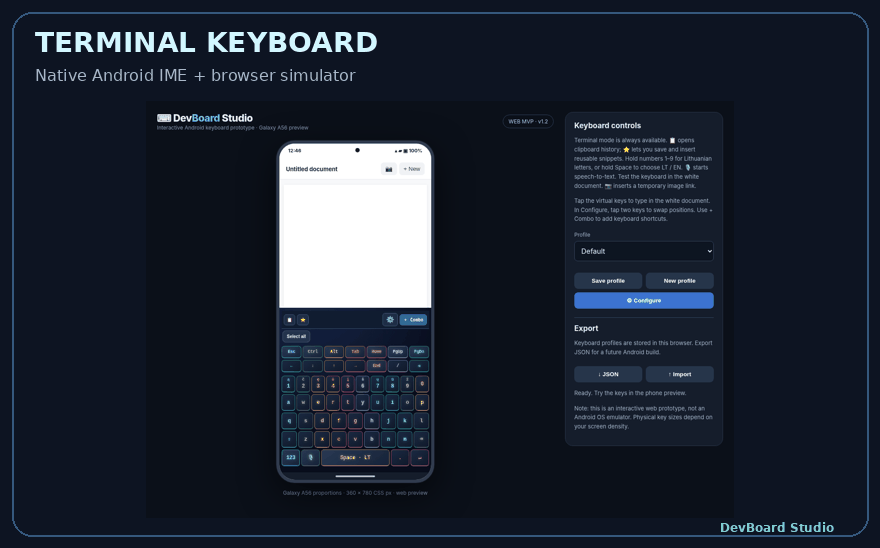

# DevBoard ⌨️

A native developer keyboard for Android and iOS, with an interactive web simulator. Built for terminals and everyday typing.



**Source version: 0.3 developer preview.** [Try the web simulator](https://krutas.github.io/Android-keyboard-for-developers/simulator.html) · [Existing downloads](https://github.com/Krutas/Android-keyboard-for-developers/releases) · [0.3 audit and limitations](docs/PARITY-0.3.md)

0.3 adds native LT/EN PC and QWERTY variants, PC Shift symbol mapping, Fn/Combo previews and editors, snippets, held-arrow repeat, layout editing and press-animation controls. Android exposes real microphone permission status; web uses browser permission APIs. iOS microphone access is unavailable to third-party keyboards.

**Full parity is not yet complete:** v0.3 keeps iOS Full Access disabled, so clipboard access is unavailable. iOS hardware shortcuts also have platform restrictions. Build success and device validation are separate; see the [verification record](docs/PARITY-0.3.md).

Space is one key with decorative `<` and `>` labels: every position inserts a normal space. Hold Space for language selection. PC layouts use Shift for number/punctuation symbols and LT number holds for accented letters; LT QWERTY has dedicated Lithuanian letters. Each language remembers its variant; Caps Lock changes letters only.

Previous verified downloads remain available: [Android 0.2.5 APK](releases/DevBoard-v0.2.5.apk), [unsigned iOS IPA](releases/DevBoard-iOS-v0.2.5-unsigned.ipa), [iOS Simulator ZIP](releases/DevBoard-iOS-v0.2.5-Simulator.zip). These do not include the 0.3 changes.

## Features

- Esc, Ctrl, Alt, Tab, arrows, Home, End, Delete, PgUp/PgDn and optional F1–F8.
- Separate snippet and clipboard menus; Android clipboard history is opt-in and excluded from password fields.
- Native layout editors: tap two keys to swap, hold for Delete, confirm Reset. Web and Android preserve variants in profile JSON.
- Android: 19 themes, appearance controls, named profiles, JSON import/export and per-app profiles.
- iOS: native SwiftUI companion settings, three themes, two profiles, App Group preferences and a UIKit keyboard extension.
- Offline emoji picker and recent emoji. Rendering depends on OS fonts.
- Android file chooser/share sheet and iOS companion Share Sheet. Web file links are local previews.

## Android build and install

Requires JDK 17, Android SDK 35 and build tools.

```bash
./gradlew :app:testDebugUnitTest :app:assembleDebug :app:lintDebug
```

APK: `app/build/outputs/apk/debug/app-debug.apk`. Successful developer-preview builds are debug-signed. Enable DevBoard in Android input settings, then select it through the system keyboard picker. Install only an artifact whose build results have been verified.

## iOS and browser verification

See [iOS build/install instructions](ios/README.md). macOS CI creates a simulator ZIP and an **unsigned** IPA. The IPA needs Apple signing/provisioning before installation on a physical iPhone.

Browser regression tests use Playwright and Chromium:

```bash
PLAYWRIGHT_MODULE=/path/to/playwright node tests/web-parity.cjs
```

CI runs the same tests and captures a screenshot. For interactive microphone tests, use HTTPS or localhost in a supported browser.

## Privacy and limits

Settings and snippets are local. DevBoard makes no custom keystroke network requests. Speech recognition may use the system/browser provider's cloud service. iOS Full Access remains disabled in v0.3; the clipboard feature is unavailable there. Password fields may use the system keyboard. Terminal key support depends on the receiving app.

[Release history](docs/CHANGELOG.md) · [Test checklist](docs/TESTING.md) · [License](LICENSE)
