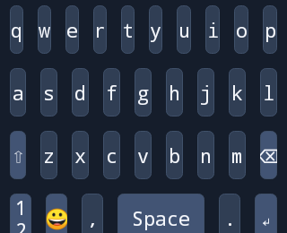
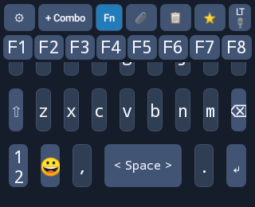

# Android 0.3 checklist audit — 2026-11-12

Audited the Android requirements in [TESTING.md](TESTING.md), using its current 0.3 section as authoritative. The older Space edge-insertion and F1–F12 checklists are historical: 0.3 requires decorative brackets, one space at every position, and an optional F1–F8 strip. Baseline source: `4f7e61c0a887e2fefc51c6bdd70037fb43d4cbc6`.

Changes are limited to Android rendering, Android tests and this verification record. No iOS source, version, release asset or publishing workflow changed. No release was published.

## Diagnosed and fixed

**Invisible Space brackets.** `setSingleLine(true)` also enabled horizontal text scrolling. In an attached API 35 view, the 148 × 39 px Space key had `scrollX = 524214` after pre-draw. Android centers the label in a very wide text layout and scrolls to it; the custom brackets were drawn at unscrolled x coordinates and disappeared outside the viewport. This was a coordinate error, not a missing glyph or low-contrast color. [Android's TextView implementation](https://github.com/aosp-mirror/platform_frameworks_base/blob/android-15.0.0_r1/core/java/android/widget/TextView.java) implements the single-line scrolling/text layout behavior.

The shared Android `SpaceKeyButton` disables horizontal scrolling, reserves padding for the decorations, and fits the center label within the available space. Bracket drawing also accounts for the scroll origin. Both the IME and settings preview now use literal `<` and `>` with the same renderer; the preview previously used different `‹ ›` characters. Touch handling remains one button: edge and center taps each insert one normal space; holding opens language selection.

| Before: brackets missing | After: three visible labels |
| --- | --- |
|  |  |

**Fn visibility.** The toolbar and function strip lived inside the same vertical `ScrollView` as all seven keyboard rows. With height 54 dp, gap 8 dp and a 320 × 260 dp viewport, toggling Fn retained `scrollY = 290` while the function row began at y = 43. The eight buttons existed but were outside the visible viewport. Separately, the emoji render branch returned before adding the Fn strip. Function labels also had unrestricted wrapping in a fixed 31 dp row.

The toolbar and F1–F8 now occupy a fixed header above the scrolling body, including in emoji mode. The body still scrolls to reach the bottom row. Function labels use one line with size fitting; Fn displays its selected state and an on/off accessibility description. F1–F8 still send the corresponding key-down/key-up pairs, preserve active Ctrl/Alt/Shift modifiers and release one-shot modifiers after dispatch.

| Before: scrolled below Fn | After: Fn remains above the scrolled body |
| --- | --- |
|  |  |

These are Robolectric native graphics renders of Android views, not photographs or emulator screenshots. The before/after Fn views use the same 320 × 260 viewport and maximum app font, key height and gap. Space comparisons use default settings. [Baseline failures and measurements](evidence/android-0.3/before-results.txt) record both failing diagnostic tests before the fixes.

## Checklist coverage

| Current Android acceptance item | Evidence and limits |
| --- | --- |
| Four LT/EN PC/QWERTY variants; remembered selection | Mapping tests check layout construction and alphabet coverage. Settings tests save edits for all four variants, export/import them, clone/reset/delete a profile, and check independent language selections. Actual language-switch menu selection is exercised. Device relaunch remains manual. |
| Shift, Caps Lock and literal symbol pages | Mapping tests cover PC punctuation/number shifts and Caps affecting letters only. IME interaction test checks one-shot Shift reset, held Caps Lock, letter/number output and literal symbols. Double-tap timing still needs device validation. |
| Nine LT number holds and LT QWERTY alphabet | Source mapping has all nine hold letters; alphabet coverage includes all nine LT and 26 Latin letters. Actual number-hold popup selection remains manual. |
| Fn, enabled combos and preview | Tests verify eight visible one-line F labels at narrow/wide measurements, selected Fn state, persisted setting across input-view restart, all eight hardware events with Ctrl+Alt, modifier release, enabled/disabled combo filtering, combo dispatch, settings preview and Fn toggling in emoji mode. Recording/edit/delete workflows and receiving-terminal behavior remain manual. |
| Exact snippets; separate clipboard; password blocking | UI insertion preserves leading spaces, blank lines and trailing newline. Clipboard history stays separate. A password field rejects clipboard UI and history capture. Snippet editor edit/delete remains manual. |
| Held arrows, release/slide/cancel/switch/rotate | Tests hold an arrow and Backspace and check that callbacks stop on release, cancellation, sliding outside, render rebuild and input-view finish. Physical keyboard switching, actual rotation, every arrow direction and editor selection behavior remain manual. |
| Swap/delete/reset; variant/profile JSON | Layout editor tests perform swap, hold-delete, Cancel Reset and confirmed Reset. Four custom variant rows survive JSON round trip; clone reset leaves the original intact. Main settings Reset has a separate gap below. |
| Animation setting and other holds | Tests toggle the stored setting, restart the input view, observe key scale feedback, insert Space and repeat Backspace in each state. Space hold language selection and held Shift are covered. Punctuation popup positioning remains manual. |
| Space positions and narrow labels | Native pixel checks verify both brackets and center text on letters and both symbol pages at widths 320/360/720, font 22 sp, key height 30 dp and gap 8 dp. Edge/center taps insert exactly nine spaces across the three pages. Separate 150% system-font test checks Space and F-key glyph bounds. Emoji Space and other labels have gaps below. |
| Mic permission and dictation | Tests show required/granted/revoked permission status, route an ungranted mic tap to the permission activity, report no installed recognizer, and reject a late result after finishing a simulated active session. Actual Android permission dialogs, permanent denial, LT/EN speech, Finish/Cancel interaction and microphone level/network behavior remain manual. |
| Older install/device checks | Debug APK build, version metadata and signature are checked. Installation/IME picker, actual app-specific profiles, file/share chooser, accessibility, orientation, disable/reenable and OS emoji glyph coverage have not been device-tested here. |

## Remaining gaps

- Emoji mode replaces the normal rows with ABC, emoji categories/grid and Backspace. It has no Space key, so the current checklist's Space-in-emoji requirement is unmet. Fn remains available there after this fix.
- Main settings **Reset keyboard layout** immediately resets rows. The layout editor's reset correctly asks for confirmation and passes the cancel/confirm test, but the separate main settings path does not.
- Other labels can still clip or wrap at extreme appearance settings. The [150% font render](evidence/android-0.3/font150-after.png) shows examples in the toolbar and terminal rows. The targeted Space and F1–F8 labels fit; this is not a claim that every label fits.
- No physical Android device or emulator was available for this audit. Layout measurement at several widths does not establish actual rotation, IME window/inset behavior or Samsung-specific rendering. Keyboard hardware event support still depends on the receiving app.

These gaps are recorded rather than changing unrelated behavior in this visibility fix. Manual checkboxes in TESTING.md remain unchecked.

## Reproduce verification

JDK 17, Android SDK/build tools 35, Gradle wrapper 8.10.2. [Robolectric 4.17](https://robolectric.org/getting-started/) is a test-only dependency; native view tests run against API 35 with an attached Activity hierarchy, pre-draw and real Android text/bitmap rendering. They use a recording input connection instead of a host editor or microphone. Robolectric downloads its Android test runtime on the first run.

```bash
./gradlew --no-daemon :app:testDebugUnitTest :app:assembleDebug :app:lintDebug
PLAYWRIGHT_MODULE=/path/to/playwright node tests/web-parity.cjs
python3 -B -m unittest discover -s tests -p 'test_*.py'
```

Results: 15 Android tests passed (3 mapping/parser, 10 native view/interaction, 2 settings/editor), debug build passed, lint passed with **0 errors and 43 warnings**. Existing browser parity tests passed. All 11 Python publication-gate unit tests passed; those tests do not publish anything. [Recorded test cases and APK verification](evidence/android-0.3/verification.txt) include the local APK SHA-256.

APK metadata remains `lt.krutas.devboard`, version `0.3` / code `9`, debug-signed; APK Signature Scheme v2 verification passes. The local artifact is `app/build/outputs/apk/debug/app-debug.apk`. Generated test reports are under `app/build/reports/tests/testDebugUnitTest/`; native screenshots regenerate under `app/build/reports/keyboard/`. Existing release downloads were not replaced.
